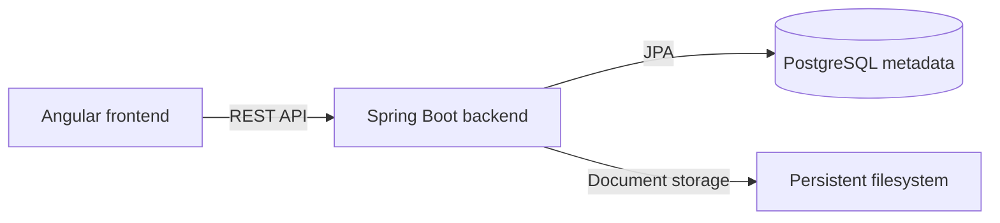

# TOGAFmate

TOGAFmate is a web application for managing and reading collections of Knowledge Base documents. The project specifications and detailed product requirements are in [SPECS.md](SPECS.md). This README describes the current implementation and explains how to run and test the application.

## Quick Start

### Build

Install Java 21. From the repository root, build the backend on Windows:

```powershell
cd backend
.\gradlew.bat clean build
```

On macOS or Linux, use `./gradlew clean build` from the `backend` directory. The build runs the backend tests against the in-memory H2 database at `jdbc:h2:mem:togafmate-test`, using user `sa` and an empty password. Tests do not need PostgreSQL. This H2 URL is for tests only—the running application uses PostgreSQL. No H2 web console is configured. See the [H2 Database Engine](https://h2database.com/) and its [FAQ](https://h2database.com/html/faq.html) for H2 details and connection defaults.

### Run

Make sure PostgreSQL is running with a database named `togafmate` (create it with `CREATE DATABASE togafmate;` if needed). From the repository root in Windows PowerShell, set a local bootstrap administrator and start the API:

```powershell
$env:APP_BOOTSTRAP_ADMIN_USER_ID = "admin"
$env:APP_BOOTSTRAP_ADMIN_PASSWORD = "<choose-a-local-password>"
cd backend
.\gradlew.bat bootRun
```

On macOS or Linux:

```bash
export APP_BOOTSTRAP_ADMIN_USER_ID=admin
export APP_BOOTSTRAP_ADMIN_PASSWORD='<choose-a-local-password>'
cd backend
./gradlew bootRun
```

### Run the frontend

Install Node.js 24. From the repository root, open a second terminal while the API is running. On Windows PowerShell:

```powershell
cd frontend
npm.cmd install
npm.cmd start
```

On macOS or Linux:

```bash
cd frontend
npm install
npm start
```

Open <http://localhost:4200>. The development server forwards `/api` requests to `http://localhost:8080`, so the frontend and backend can run in separate terminals without additional local CORS setup.

Sign in with the bootstrap administrator credentials configured for the backend. The current frontend supports:

1. Signing in with a user ID and password and using the returned permissions to control available pages.
2. Browsing and searching registered Knowledge Base metadata as a reader or administrator.
3. Registering Knowledge Base metadata and granting or revoking a user's reader or administrator permission from the Admin area.
4. Choosing the Light, Gray, or Black theme.

New users are created through `POST /api/users/register` (see **Try the API in Swagger**) and start with `NO_ACCESS`; an administrator can then grant them reader access in the frontend. The backend currently has no ZIP upload or document retrieval endpoints. The frontend therefore displays Knowledge Base details but cannot yet import ZIP files or render Markdown documents. Replacement and removal are also not available in the current API.

For local development, HTTP on localhost is supported. Production deployments must serve both the frontend and API over HTTPS, with the production web server or reverse proxy routing `/api` to the backend. Docker deployment is planned; Docker by itself does not configure HTTPS.

The default PostgreSQL connection is `jdbc:postgresql://localhost:5432/togafmate` with user `postgres` and an empty password. Set `DB_URL`, `DB_USERNAME`, and `DB_PASSWORD` before starting to use different connection values. The API starts at `http://localhost:8080`.

### Try the API in Swagger

Open [Swagger UI](http://localhost:8080/swagger-ui/index.html). Select **Authorize** and enter the bootstrap administrator ID and the local password you chose. Use these local test values:

1. Try `GET /api/health`; it is public.
2. Try `POST /api/knowledge-bases` with the administrator authorized and this JSON body:

   ```json
   {
     "title": "TOGAF Demo Guide",
     "folderNameVersion": "TOGAF_Demo_Guide_v1.0",
     "version": "1.0",
     "contentType": "Free",
     "description": "Local Swagger test entry"
   }
   ```

   This creates Knowledge Base metadata; ZIP upload and document storage are not implemented yet.

3. Try `POST /api/users/register` with `{"userID":"reader.demo","password":"DemoReaderPassword123!"}`. New users receive `NO_ACCESS` by default.
4. While authorized as the administrator, try `PUT /api/users/reader.demo/permissions` with `{"permission":"USER_ACCESS"}`.
5. Try `POST /api/users/logon` with `{"userID":"reader.demo","password":"DemoReaderPassword123!"}`. The response includes permissions and never includes the password.
6. To test reader access, select **Authorize** again with `reader.demo` and its sample password, then call `GET /api/knowledge-bases`.

These sample values are for local testing only. Protected API calls use HTTP Basic authorization; use HTTPS when deploying outside local development.

## Docker Images and Deployment

Docker deployment is planned in two stages. Stage 1 builds and publishes separate frontend and backend images. Stage 2 will add Docker Compose orchestration and PostgreSQL.

### Stage 1: Build and publish images

Install Docker Desktop or Docker Engine and make sure the Docker daemon is running. The Dockerfiles are in `frontend/Dockerfile` and `backend/Dockerfile`.

The frontend image builds Angular with Node.js and serves the production files from Alpine-based Nginx. It listens on port `8080` and forwards `/api` requests to a backend container reachable as `backend:8080`. The backend image builds the Spring Boot API and runs on Ubuntu 24.04 with Java 21. It listens on port `8080` and expects its database and bootstrap administrator settings through runtime environment variables. These application images do not include PostgreSQL.

Sign in to Docker Hub. Docker prompts for credentials; use a Docker Hub access token if that is how your account is configured. Do not put credentials or tokens in these instructions or in the image:

```shell
docker login
```

Replace the namespace below with your Docker Hub username or organization. Create the two Docker Hub repositories first if they do not already exist. Run these commands from the repository root:

```shell
docker build --build-arg APP_VERSION=1.0 -t <dockerhub-namespace>/togafmate-frontend:1.0 ./frontend
docker build --build-arg APP_VERSION=1.0 -t <dockerhub-namespace>/togafmate-backend:1.0 ./backend
```

For example, if your Docker Hub namespace is `architectureteam`, the frontend build command is:

```shell
docker build --build-arg APP_VERSION=1.0 -t architectureteam/togafmate-frontend:1.0 ./frontend
```

Push both images after the builds finish successfully:

```shell
docker push <dockerhub-namespace>/togafmate-frontend:1.0
docker push <dockerhub-namespace>/togafmate-backend:1.0
```

The `<dockerhub-namespace>` text is a placeholder; replace it with your actual namespace in each command. The `1.0` image tag and `APP_VERSION` label identify this Stage 1 release. Never pass passwords, database credentials, or bootstrap secrets as Docker build arguments or copy them into an image.

### Stage 2: Run the complete stack

Stage 2 will add a root-level `compose.yaml` that runs the frontend image, backend image, and an official PostgreSQL image as separate services on a shared network. The frontend will reach the backend by the service name `backend`; the backend will connect to PostgreSQL by its Compose service name.

Stage 2 will also configure persistent PostgreSQL and Knowledge Base storage, runtime secrets, and HTTPS at the deployment entry point. The PostgreSQL image should use a pinned supported major version rather than the floating `latest` tag. A local `.env` file may supply Compose variables, but it must be ignored by Git and kept out of the images; a placeholder-only `.env.example` can be committed. Production secrets should be injected by the deployment environment or a secrets manager.

## Architecture

The target design separates the web client, REST API, metadata database, and file storage:



The repository contains the Angular frontend and Spring Boot backend. Stage 1 Dockerfiles are available for publishing separate application images. Compose orchestration, PostgreSQL container configuration, persistent volumes, HTTPS deployment, Knowledge Base file import, and document retrieval remain planned work described in `SPECS.md`.

## Technology

- Java 21 and Spring Boot
- Gradle with Kotlin DSL
- Spring Data JPA and PostgreSQL
- Spring Security with BCrypt password hashes and HTTP Basic authorization
- Swagger UI for API exploration
- H2 in-memory database for tests

## Configuration

The default PostgreSQL URL is `jdbc:postgresql://localhost:5432/togafmate`, with username `postgres` and an empty password. Override these defaults with `DB_URL`, `DB_USERNAME`, and `DB_PASSWORD`. JPA schema management defaults to `update`; set `JPA_DDL_AUTO` to change it.

Set both `APP_BOOTSTRAP_ADMIN_USER_ID` and `APP_BOOTSTRAP_ADMIN_PASSWORD` to provision the first administrator at startup. The password is BCrypt-encoded before storage. Keep these values outside the repository.

## API and Swagger

Open [Swagger UI](http://localhost:8080/swagger-ui/index.html) or the [OpenAPI document](http://localhost:8080/v3/api-docs) while the backend is running. In Swagger UI, use **Authorize** to enter HTTP Basic credentials for protected endpoints.

| Method | Endpoint | Access | Purpose |
|---|---|---|---|
| `GET` | `/api/health` | Public | Backend process health |
| `POST` | `/api/users/register` | Public | Register an account with `NO_ACCESS` |
| `POST` | `/api/users/logon` | Public | Verify credentials and return permissions |
| `GET` | `/api/knowledge-bases` | `USER_ACCESS` or `ADMINISTRATOR_ACCESS` | List Knowledge Base metadata |
| `POST` | `/api/knowledge-bases` | `ADMINISTRATOR_ACCESS` | Validate and register Knowledge Base metadata |
| `PUT` | `/api/users/{userID}/permissions` | `ADMINISTRATOR_ACCESS` | Add a permission |
| `DELETE` | `/api/users/{userID}/permissions` | `ADMINISTRATOR_ACCESS` | Remove a permission |

Permission request bodies use an enum value, for example `{"permission":"USER_ACCESS"}`. Available values are `USER_ACCESS`, `ADMINISTRATOR_ACCESS`, and `NO_ACCESS`. Protected requests use HTTP Basic credentials; use HTTPS when deploying outside local development.

Knowledge Base registration requires `title`, `folderNameVersion`, `version`, and `contentType`. Allowed content types are `Free`, `Open-source`, and `Copyrighted`. Optional metadata includes `author`, `emailAddress`, `tableOfContents`, and `description`.

The Angular development origin `http://localhost:4200` is allowed by default. Set `APP_CORS_ALLOWED_ORIGINS` to a comma-separated list of exact origins for other environments.

## Test

Tests use an in-memory H2 database, so PostgreSQL does not need to be running for the test suite.

From the `backend` directory, run on Windows:

```powershell
.\gradlew.bat test
```

On macOS or Linux:

```bash
./gradlew test
```

JaCoCo reports are generated under `backend/build/reports/jacoco/test/`.

## Repository layout

```text
AGENTS.md       Coding and collaboration instructions
README.md       Project overview, architecture, and usage instructions
SPECS.md        Canonical project requirements and specifications
backend/        Spring Boot REST API and tests
frontend/       Angular frontend
```
