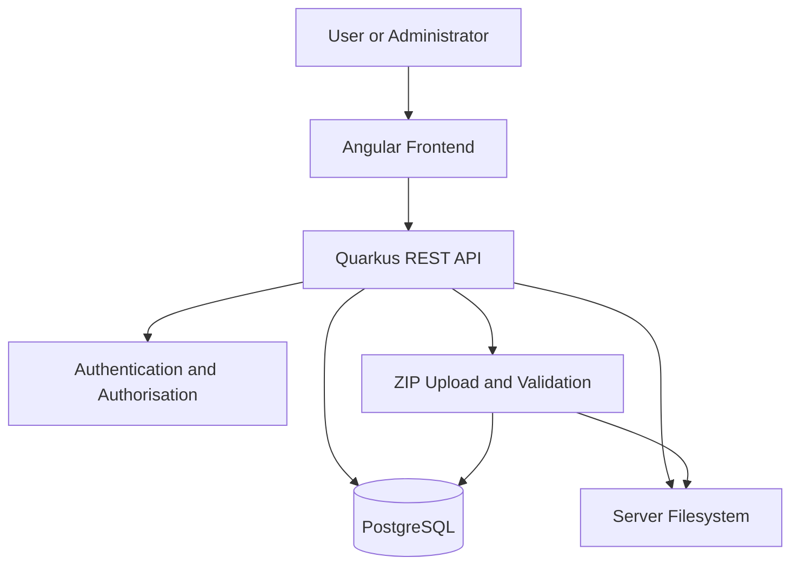

# TOGAFmate

**TOGAFmate** is an open-source Knowledge Bases application designed to help users organise, access, navigate, and read collections of knowledge documents through a web-based interface.

The application supports multiple Knowledge Bases, each containing Markdown documents and associated resources such as images. Knowledge Bases can contain learning material, technical documentation, reference information, and other authorised content.

TOGAFmate uses Angular for the frontend, Java with Quarkus for the backend, PostgreSQL for metadata and access control, and the server filesystem for document storage.

TOGAFmate is released under the **GNU General Public License v3.0 (GPL-3.0)**.

## 1. Objectives

TOGAFmate aims to provide:

- A central application for managing multiple Knowledge Bases.
- A consistent structure for all Knowledge Bases.
- A web-based interface for browsing and reading documents.
- ZIP-based Knowledge Base uploads.
- Filesystem storage for Markdown documents and supporting resources.
- PostgreSQL storage for metadata and access permissions.
- Version identification for each Knowledge Base.
- Access control for readers and administrators.
- A secure mechanism for uploading, replacing, and removing Knowledge Bases.
- A containerised deployment model.
- An open-source platform that can be extended by the community.

## 2. Initial Features

### 2.1 Knowledge Base Management

TOGAFmate will support multiple independent Knowledge Bases.

Each Knowledge Base will have its own collection of documents and supporting resources.

Knowledge Bases may contain:

- Learning material.
- Technical documentation.
- Product documentation.
- Reference material.
- Standards and guidelines.
- Training material.
- Other authorised knowledge content.

Each Knowledge Base will have a title, version, description, content type, storage identifier, and associated document metadata.

Administrators will manage the Knowledge Base collection through the application.

### 2.2 Knowledge Base Content

A Knowledge Base will contain Markdown documents and any supporting resources required by those documents.

Supported content may include:

- Markdown files (`.md`).
- Images used by Markdown documents.
- Other supporting resources approved by the application.

The initial implementation will focus on Markdown documents and associated images.

The application will display Markdown content in a readable format through the Angular frontend.

### 2.3 Knowledge Base Navigation

Users will be able to browse the Knowledge Bases they are authorised to access.

The application will provide a Table of Contents for each Knowledge Base.

Users will be able to:

- Select a Knowledge Base.
- View its Table of Contents.
- Select a document.
- Read the document.
- Navigate to other documents within the same Knowledge Base.
- View associated images and other authorised resources.

The application will not require users to download an entire Knowledge Base to read an individual document.

### 2.4 Knowledge Base Import

Administrators will upload each Knowledge Base as a single ZIP file.

The backend will:

1. Receive the uploaded ZIP file.
2. Validate the archive and its contents.
3. Verify the required Knowledge Base structure.
4. Extract the files into the configured server filesystem.
5. Register the Knowledge Base and its documents in PostgreSQL.
6. Make the Knowledge Base available to authorised users.

The files will be extracted once during import. Subsequent document requests will read the extracted files rather than repeatedly extracting the ZIP archive.

### 2.5 Knowledge Base Administration

Administrators will be able to:

- Upload a Knowledge Base.
- Register its metadata.
- Replace an existing Knowledge Base version.
- Remove a Knowledge Base.
- Manage access permissions.
- View the registered documents and their metadata.

The application must validate changes before activating a new or replacement Knowledge Base.

### 2.6 Search and Discovery

The initial application will provide basic Knowledge Base discovery.

Users should be able to locate Knowledge Bases and documents using available metadata, including:

- Knowledge Base title.
- Version.
- Description.
- Content type.
- Document name.
- Document title.
- Relevant tags, where supported.

More advanced full-text, semantic, and AI-assisted search may be considered for future releases.

## 3. Knowledge Base Content Types

Each Knowledge Base must specify one of the following content types.

### 3.1 Free

Content made available without a charge, subject to the applicable licence, copyright, and usage terms.

### 3.2 Open-source

Content distributed under an identified open-source licence or other applicable open licence.

The relevant licence must be identified where applicable.

### 3.3 Copyrighted

Content subject to copyright restrictions and the permissions granted by its copyright owner.

The administrator must ensure that the application is authorised to store and provide access to this content.

### 3.4 Content Type and Licensing

The content type describes the intended usage or distribution category of a Knowledge Base.

It does not replace the actual licence, copyright notice, or permission terms.

TOGAFmate must not assume that content is free to copy, modify, or redistribute simply because it is available without charge.

## 4. Application Architecture

TOGAFmate will use a web application architecture consisting of an Angular frontend, a Java/Quarkus backend, PostgreSQL, and filesystem storage.

### 4.1 Architecture Overview



### 4.2 Angular Frontend

The Angular frontend will provide the user interface for:

- Browsing Knowledge Bases.
- Displaying Knowledge Base information.
- Displaying Tables of Contents.
- Reading Markdown documents.
- Displaying associated images.
- Uploading Knowledge Bases for administrators.
- Managing Knowledge Base metadata.
- Managing access permissions.

The frontend will communicate with the backend through REST APIs.

The frontend must not access the server filesystem or PostgreSQL directly.

### 4.3 Java and Quarkus Backend

The Quarkus backend will implement the application's business logic and REST APIs.

Its responsibilities will include:

- Authentication and authorisation integration.
- Knowledge Base administration.
- ZIP upload and validation.
- Safe extraction of uploaded archives.
- Knowledge Base and document metadata management.
- Filesystem access.
- Document retrieval.
- Table of Contents data retrieval.
- Access permission enforcement.
- Error handling and audit logging for administrative operations.

The backend will be responsible for ensuring that users only access Knowledge Bases and documents for which they have permission.

### 4.4 PostgreSQL

PostgreSQL will store structured application data, including:

- Knowledge Base metadata.
- Knowledge Base version information.
- Document metadata.
- Knowledge Base and document relationships.
- User and role references where required.
- Access permissions.
- Administrative audit information where required.

The database will not store duplicate copies of the Markdown documents or their supporting files.

### 4.5 Filesystem Storage

The server filesystem will store the actual Knowledge Base content.

This includes:

- Markdown documents.
- Images.
- Other permitted supporting resources.
- Any additional files approved by the import rules.

The storage root will be configured by the application administrator.

An uploaded archive must not be allowed to determine or override the server's storage root.

### 4.6 Separation of Responsibilities

The application will maintain a clear separation between:

- **Angular:** user interface and navigation.
- **Quarkus:** application logic, APIs, security, and file access.
- **PostgreSQL:** metadata, permissions, and application records.
- **Filesystem:** actual Knowledge Base documents and supporting resources.

This separation avoids storing duplicate document content in the database and keeps the implementation straightforward.

## 5. Technology Stack

| Component | Technology |
|---|---|
| Frontend | Angular |
| Backend | Java / Quarkus |
| API | REST |
| Database | PostgreSQL |
| Document storage | Server filesystem |
| Import format | ZIP |
| Document format | Markdown |
| Build | Gradle |
| Testing | JUnit |
| Code coverage | JaCoCo |
| Code quality | SonarQube |
| Containerisation | Docker |
| IDE | IntelliJ IDEA Community Edition |

The initial implementation will be designed to run locally using Docker and will also support development directly from IntelliJ IDEA Community Edition.

## 6. Knowledge Base Structure

Each Knowledge Base must follow the same folder structure.

The Knowledge Base folder name will be derived from its title and version number. The folder name must be unique within the Knowledge Base storage directory.

### 6.1 Example Folder Structure

```text
knowledge-bases/
└── TOGAF_Architecture_Guide_v1.0/
    ├── README.md
    ├── TABLE_OF_CONTENTS
    ├── 01_Introduction.md
    ├── 02_Architecture_Principles.md
    ├── 03_Business_Architecture.md
    ├── 04_Data_Architecture.md
    └── images/
        └── architecture.png
```

The structure is illustrative. The number and names of Markdown documents will depend on the Knowledge Base content.

Every Knowledge Base must include:

- A `README.md` file.
- A `TABLE_OF_CONTENTS` resource.
- Its Markdown documents.
- Any supporting resources required by those documents.

### 6.2 Folder Naming Convention

The folder name will contain the Knowledge Base title and version.

For example:

- Knowledge Base title: `TOGAF Architecture Guide v1.0`
- Folder name: `TOGAF_Architecture_Guide_v1.0`

The folder name will be used as a storage identifier.

The backend will determine the actual filesystem location by combining the configured storage root with the validated Knowledge Base identifier.

The application must not accept arbitrary filesystem paths from uploaded content.

## 7. Knowledge Base README.md

Each Knowledge Base must contain a `README.md` file describing the Knowledge Base.

The README will provide the information required to identify and understand the content.

### 7.1 Title and Version Number

The title must include the Knowledge Base version number.

Example:

```text
TOGAF Architecture Guide v1.0
```

The title and version number will be used to determine the Knowledge Base folder name.

Example:

```text
TOGAF_Architecture_Guide_v1.0
```

The folder name must be unique within the configured Knowledge Base storage directory.

### 7.2 Description

The README must contain a short description explaining the purpose and contents of the Knowledge Base.

For example:

> A collection of learning materials covering TOGAF architecture concepts and the Architecture Development Method (ADM).

### 7.3 Knowledge Base Content Type

The README must identify one of the supported content types:

- Free.
- Open-source.
- Copyrighted.

The relevant licence or copyright terms must also be respected.

### 7.4 Target Folder

The README must identify the intended Knowledge Base folder.

For example:

```text
TOGAF_Architecture_Guide_v1.0
```

The target folder is an identifier, not an arbitrary filesystem path.

The actual storage location will be determined by the Quarkus backend configuration.

### 7.5 Example README.md

```markdown
# TOGAF Architecture Guide v1.0

## Description

A collection of learning materials covering TOGAF
architecture concepts and the Architecture Development
Method (ADM).

## Knowledge Base Content Type

Open-source

## Target Folder

TOGAF_Architecture_Guide_v1.0
```

The README structure must be consistent across all Knowledge Bases.

The backend will validate the required fields and verify that the folder identifier conforms to the application's naming rules.

## 8. Table of Contents

Each Knowledge Base will have a separate `TABLE_OF_CONTENTS` resource.

The Table of Contents will provide the navigation structure for the documents within that Knowledge Base.

### 8.1 Table of Contents Responsibilities

The Table of Contents will allow users to:

- See the available documents.
- Identify document titles.
- Select a document to read.
- Navigate between documents.
- Access supporting resources where authorised.

The Table of Contents is a navigation mechanism. It is not a second copy of the document content.

### 8.2 Table of Contents Data

The application will use the Knowledge Base files and document metadata to provide navigation.

The initial design will follow this process:

1. PostgreSQL stores metadata for each registered document.
2. The backend identifies the documents belonging to a Knowledge Base.
3. The backend provides the navigation data through a REST API.
4. Angular displays the Table of Contents.
5. The user selects a document.
6. The backend checks authorisation.
7. The backend retrieves and returns the requested Markdown content.

### 8.3 Table of Contents Implementation

Two implementation options have been identified:

**Option A — Angular component**

The backend provides document metadata through a REST API. Angular builds and displays the Table of Contents dynamically.

**Option B — HTML resource**

The Knowledge Base contains an HTML Table of Contents that the frontend displays or integrates into its navigation.

The implementation approach will be decided during detailed design.

Regardless of the chosen approach, the backend must enforce authorisation whenever a document or supporting resource is requested.

## 9. Common Storage and Processing

All Knowledge Bases will use the same storage and processing mechanism.

### 9.1 Import Process

The import process will:

1. Receive a ZIP file from an administrator.
2. Validate the archive.
3. Check the required Knowledge Base structure.
4. Validate the README and required metadata.
5. Check file types and archive limits.
6. Extract the files into a temporary directory.
7. Validate the extracted content and resource paths.
8. Move or activate the validated content in the configured storage directory.
9. Register the Knowledge Base and document metadata in PostgreSQL.
10. Make the Knowledge Base available according to its access permissions.

The application must avoid exposing partially uploaded or invalid Knowledge Bases.

### 9.2 Document Retrieval

When a user requests a document:

1. The backend identifies the requested Knowledge Base.
2. The backend checks the user's access permissions.
3. The backend validates the requested document identifier or path.
4. The backend locates the file within the configured Knowledge Base directory.
5. The backend reads the document from the filesystem.
6. The backend returns the content to the frontend.

The backend must not permit a request to access files outside the authorised Knowledge Base.

### 9.3 Filesystem and Database Responsibilities

The filesystem stores the actual content.

PostgreSQL stores metadata and application information.

For example:

| Information | Storage location |
|---|---|
| Knowledge Base Markdown files | Filesystem |
| Images and supporting resources | Filesystem |
| Knowledge Base README | Filesystem |
| Table of Contents resource | Filesystem |
| Knowledge Base title and version metadata | PostgreSQL |
| Document metadata | PostgreSQL |
| Access permissions | PostgreSQL |
| Administrative audit information | PostgreSQL, where required |

The application will not maintain duplicate copies of the Markdown documents in PostgreSQL.

### 9.4 Replacing a Knowledge Base

When an administrator replaces a Knowledge Base, the application must validate the replacement before making it available.

The application must prevent users from accessing an incomplete replacement.

The implementation must also define how failed imports are rolled back and how previous versions are retained or removed.

The exact replacement and retention policy will be decided during detailed design.

## 10. Access Control and Security

TOGAFmate will distinguish between readers and administrators.

### 10.1 Readers

Readers will be able to:

- Browse Knowledge Bases they are authorised to access.
- View their Tables of Contents.
- Read authorised Markdown documents.
- Access authorised supporting resources.

Readers will not be able to upload, replace, or remove Knowledge Bases or change permissions.

### 10.2 Administrators

Administrators will be able to:

- Upload Knowledge Bases.
- Manage Knowledge Base metadata.
- Replace or remove Knowledge Bases.
- Manage access permissions.
- Maintain the Knowledge Base collection.
- Review administrative operations where audit logging is implemented.

Administrative functions must be protected against unauthorised use.

### 10.3 Server-Side Authorisation

The backend must enforce authorisation for every protected operation.

This includes:

- Listing restricted Knowledge Bases.
- Reading document content.
- Accessing images and other resources.
- Uploading ZIP files.
- Replacing Knowledge Bases.
- Removing Knowledge Bases.
- Changing permissions.

Hiding links or buttons in Angular is not sufficient security.

The backend must independently verify the user's permissions before performing the requested operation.

### 10.4 ZIP Upload Security

Uploaded ZIP files must be treated as untrusted input.

The backend must protect against:

- ZIP path traversal, commonly called Zip Slip.
- Attempts to write outside the configured storage directory.
- Absolute paths and unsafe path components.
- Unexpected file types.
- Excessive archive sizes.
- Excessive numbers of files.
- Excessive extracted sizes.
- Malformed or corrupted archives.
- Unexpected directory structures.
- Unsafe references to supporting resources.

The backend must use a server-configured storage root and must not trust filesystem paths supplied by the archive.

### 10.5 Safe Activation

A Knowledge Base must not become available until validation and extraction have completed successfully.

The application should extract content to a temporary directory and activate it only after validation.

If an import fails, the application must clean up temporary files and avoid leaving inconsistent metadata or partially active content.

## 11. Development Principles

TOGAFmate will follow these development principles:

- Open-source development under GPL-3.0.
- API-first development.
- Separation of frontend and backend.
- Separation of metadata from document content.
- PostgreSQL for structured metadata and permissions.
- Filesystem storage for Markdown and supporting resources.
- Consistent structure for all Knowledge Bases.
- ZIP as the initial import format.
- Secure document access through the backend.
- Server-side authorisation for all protected operations.
- Automated testing.
- Continuous code-quality analysis.
- Containerised deployment.
- Prefer proven technologies over reinventing functionality.
- Keep the platform extensible.
- Maintain clear and complete documentation.

## 12. Initial Project Scope

The initial release will concentrate on establishing the core Knowledge Bases application.

The scope includes:

1. Angular web interface.
2. Java/Quarkus backend.
3. REST API.
4. PostgreSQL database.
5. Knowledge Base metadata management.
6. Document metadata management.
7. ZIP upload and validation.
8. Safe extraction to the server filesystem.
9. Knowledge Base folder structure validation.
10. README validation.
11. Table of Contents display.
12. Markdown document retrieval and display.
13. Supporting image retrieval.
14. Reader and administrator roles.
15. Access permission management.
16. Server-side authorisation.
17. Safe replacement and removal of Knowledge Bases.
18. Docker containerisation.
19. Automated testing.
20. JaCoCo code coverage.
21. SonarQube integration.

Additional capabilities, including advanced search and AI-assisted knowledge discovery, may be introduced in later releases.

### 12.1 Excluded Applications and Responsibilities

TOGAFmate is the **Knowledge Bases application**.

The following capabilities belong to separate programs and are not part of this application's scope:

- A TOGAF Architecture Repository for managing architecture artefacts and their governance workflows.
- An Architecture Decision Repository for managing architecture decisions and their lifecycle.

TOGAFmate will not implement those repositories as modules within this application.

Its responsibility is to manage Knowledge Bases and provide secure access to their content.

## 13. Project Status

**Status: PLANNING**

TOGAFmate is currently in the planning and initial design phase.

The core technology choices and Knowledge Base storage approach have been identified. Detailed design is still required for areas such as the final Table of Contents implementation, authentication integration, database schema, replacement policy, and API contracts.

The project will progress through requirements definition, detailed design, implementation, testing, and deployment.

## 14. Contributing

TOGAFmate is intended to be an open-source project, and contributions are welcome.

Contributors will be able to participate in:

- Application development.
- Backend development.
- Frontend development.
- Database design.
- Security and access control.
- User interface and user experience.
- Knowledge Base examples.
- Documentation.
- Testing.
- Feature development.

Contribution guidelines will be added as the project matures.

## 15. License

TOGAFmate is licensed under the **GNU General Public License version 3.0 (GPL-3.0)**.

The software may be used, modified, and distributed in accordance with the terms of that licence.

When distributing the software or derivative works, the applicable GPL-3.0 requirements must be followed.

The licence for the TOGAFmate application does not automatically determine the licence or usage rights of documents uploaded into its Knowledge Bases. Knowledge Base administrators remain responsible for ensuring that uploaded content may lawfully be stored and made available to its intended users.

For the complete licence terms, see the [GNU General Public License v3.0](https://www.gnu.org/licenses/gpl-3.0.htm).

The repository should include the corresponding `LICENSE` file.
