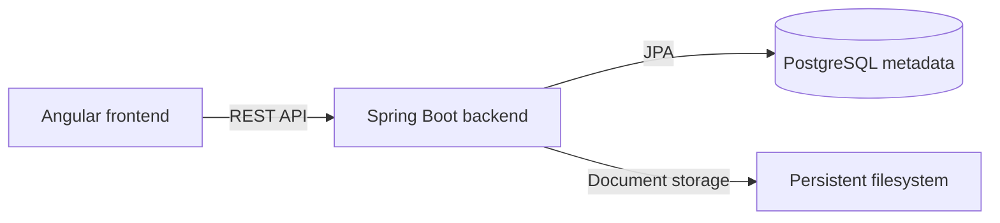

# TOGAFmate

TOGAFmate is a web application for managing and reading collections of Knowledge Base documents. The project specifications and detailed product requirements are in [SPECS.md](SPECS.md). This README describes the current architecture and implementation, and explains how to run and test the backend.

## Quick Start

### Build

Install Java 21. From the repository root, build the backend on Windows:

```powershell
cd backend
.\gradlew.bat clean build
```

On macOS or Linux, use `./gradlew clean build` from the `backend` directory. The build runs the backend tests against the in-memory H2 database at `jdbc:h2:mem:togafmate-test`, using user `sa` and an empty password. Tests do not need PostgreSQL. This H2 URL is for tests only—the running application uses PostgreSQL. No H2 web console is configured. See the [H2 Database Engine](https://h2database.com/) and its [FAQ](https://h2database.com/html/faq.html) for H2 details and connection defaults.

### Run

Make sure PostgreSQL is running with a database named `togafmate` (create it with `CREATE DATABASE togafmate;` if needed). From the repository root in Windows PowerShell, set a local bootstrap administrator and start the API:

```powershell
$env:APP_BOOTSTRAP_ADMIN_USER_ID = "admin"
$env:APP_BOOTSTRAP_ADMIN_PASSWORD = "<choose-a-local-password>"
cd backend
.\gradlew.bat bootRun
```

On macOS or Linux:

```bash
export APP_BOOTSTRAP_ADMIN_USER_ID=admin
export APP_BOOTSTRAP_ADMIN_PASSWORD='<choose-a-local-password>'
cd backend
./gradlew bootRun
```

The default PostgreSQL connection is `jdbc:postgresql://localhost:5432/togafmate` with user `postgres` and an empty password. Set `DB_URL`, `DB_USERNAME`, and `DB_PASSWORD` before starting to use different connection values. The API starts at `http://localhost:8080`.

### Try the API in Swagger

Open [Swagger UI](http://localhost:8080/swagger-ui/index.html). Select **Authorize** and enter the bootstrap administrator ID and the local password you chose. Use these local test values:

1. Try `GET /api/health`; it is public.
2. Try `POST /api/knowledge-bases` with the administrator authorized and this JSON body:

   ```json
   {
     "title": "TOGAF Demo Guide",
     "folderNameVersion": "TOGAF_Demo_Guide_v1.0",
     "version": "1.0",
     "contentType": "Free",
     "description": "Local Swagger test entry"
   }
   ```

   This creates Knowledge Base metadata; ZIP upload and document storage are not implemented yet.

3. Try `POST /api/users/register` with `{"userID":"reader.demo","password":"DemoReaderPassword123!"}`. New users receive `NO_ACCESS` by default.
4. While authorized as the administrator, try `PUT /api/users/reader.demo/permissions` with `{"permission":"USER_ACCESS"}`.
5. Try `POST /api/users/logon` with `{"userID":"reader.demo","password":"DemoReaderPassword123!"}`. The response includes permissions and never includes the password.
6. To test reader access, select **Authorize** again with `reader.demo` and its sample password, then call `GET /api/knowledge-bases`.

These sample values are for local testing only. Protected API calls use HTTP Basic authorization; use HTTPS when deploying outside local development.

## Architecture

The target design separates the web client, REST API, metadata database, and file storage:



The repository currently contains the Spring Boot backend. Angular, Knowledge Base file import and retrieval, persistent document storage, and Docker deployment are planned components described in `SPECS.md`.

## Technology

- Java 21 and Spring Boot
- Gradle with Kotlin DSL
- Spring Data JPA and PostgreSQL
- Spring Security with BCrypt password hashes and HTTP Basic authorization
- Swagger UI for API exploration
- H2 in-memory database for tests

## Configuration

The default PostgreSQL URL is `jdbc:postgresql://localhost:5432/togafmate`, with username `postgres` and an empty password. Override these defaults with `DB_URL`, `DB_USERNAME`, and `DB_PASSWORD`. JPA schema management defaults to `update`; set `JPA_DDL_AUTO` to change it.

Set both `APP_BOOTSTRAP_ADMIN_USER_ID` and `APP_BOOTSTRAP_ADMIN_PASSWORD` to provision the first administrator at startup. The password is BCrypt-encoded before storage. Keep these values outside the repository.

## API and Swagger

Open [Swagger UI](http://localhost:8080/swagger-ui/index.html) or the [OpenAPI document](http://localhost:8080/v3/api-docs) while the backend is running. In Swagger UI, use **Authorize** to enter HTTP Basic credentials for protected endpoints.

| Method | Endpoint | Access | Purpose |
|---|---|---|---|
| `GET` | `/api/health` | Public | Backend process health |
| `POST` | `/api/users/register` | Public | Register an account with `NO_ACCESS` |
| `POST` | `/api/users/logon` | Public | Verify credentials and return permissions |
| `GET` | `/api/knowledge-bases` | `USER_ACCESS` or `ADMINISTRATOR_ACCESS` | List Knowledge Base metadata |
| `POST` | `/api/knowledge-bases` | `ADMINISTRATOR_ACCESS` | Validate and register Knowledge Base metadata |
| `PUT` | `/api/users/{userID}/permissions` | `ADMINISTRATOR_ACCESS` | Add a permission |
| `DELETE` | `/api/users/{userID}/permissions` | `ADMINISTRATOR_ACCESS` | Remove a permission |

Permission request bodies use an enum value, for example `{"permission":"USER_ACCESS"}`. Available values are `USER_ACCESS`, `ADMINISTRATOR_ACCESS`, and `NO_ACCESS`. Protected requests use HTTP Basic credentials; use HTTPS when deploying outside local development.

Knowledge Base registration requires `title`, `folderNameVersion`, `version`, and `contentType`. Allowed content types are `Free`, `Open-source`, and `Copyrighted`. Optional metadata includes `author`, `emailAddress`, `tableOfContents`, and `description`.

The Angular development origin `http://localhost:4200` is allowed by default. Set `APP_CORS_ALLOWED_ORIGINS` to a comma-separated list of exact origins for other environments.

## Test

Tests use an in-memory H2 database, so PostgreSQL does not need to be running for the test suite.

From the `backend` directory, run on Windows:

```powershell
.\gradlew.bat test
```

On macOS or Linux:

```bash
./gradlew test
```

JaCoCo reports are generated under `backend/build/reports/jacoco/test/`.

## Repository layout

```text
AGENTS.md       Coding and collaboration instructions
README.md       Project overview, architecture, and usage instructions
SPECS.md        Canonical project requirements and specifications
backend/        Spring Boot REST API and tests
```
