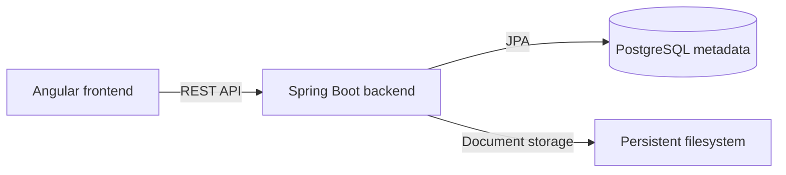

# TOGAFmate

TOGAFmate is a web application for managing and reading collections of Knowledge Base documents. The project specifications and detailed product requirements are in [SPECS.md](SPECS.md). This README describes the current implementation and explains how to run and test the application.

## 1. Quick Start

### 1.1 Build

Install Java 21. From the repository root, build the backend on Windows:

```powershell
cd backend
.\gradlew.bat clean build
```

On macOS or Linux, use `./gradlew clean build` from the `backend` directory. The build runs the backend tests against the in-memory H2 database at `jdbc:h2:mem:togafmate-test`, using user `sa` and an empty password. Tests do not need PostgreSQL. This H2 URL is for tests only—the running application uses PostgreSQL. No H2 web console is configured. See the [H2 Database Engine](https://h2database.com/) and its [FAQ](https://h2database.com/html/faq.html) for H2 details and connection defaults.

### 1.2 Run

Make sure PostgreSQL is running with the database and credentials in `docker-compose/.env`. The local file sets `ADMIN_USER=admin`; keep `ADMIN_USER_PASSWORD` in that ignored file. From the repository root in Windows PowerShell, start the API:

```powershell
cd backend
.\gradlew.bat bootRun
```

On macOS or Linux:

```bash
cd backend
./gradlew bootRun
```

### 1.3 Run the frontend

Install Node.js 24. From the repository root, open a second terminal while the API is running. On Windows PowerShell:

```powershell
cd frontend
npm.cmd install
npm.cmd start
```

On macOS or Linux:

```bash
cd frontend
npm install
npm start
```

Open <http://localhost:4200>. The development server forwards `/api` requests to `http://localhost:8999`, so the frontend and backend can run in separate terminals without additional local CORS setup.

Sign in with the bootstrap administrator credentials configured for the backend. The current frontend supports:

1. Signing in with a user ID and password and using the returned permissions to control available pages.
2. Browsing and searching registered Knowledge Base metadata as a reader or administrator.
3. Registering Knowledge Base metadata and granting or revoking a user's reader or administrator permission from the Admin area.
4. Choosing the Light, Gray, or Black theme.

New users are created through `POST /api/users/register` (see **Try the API in Swagger**) and start with `NO_ACCESS`; an administrator can then grant them reader access in the frontend. The backend currently has no ZIP upload or document retrieval endpoints. The frontend therefore displays Knowledge Base details but cannot yet import ZIP files or render Markdown documents. The API supports metadata updates and soft deactivation; it does not physically delete Knowledge Base records.

For local development, HTTP on localhost is supported. Production deployments must serve both the frontend and API over HTTPS, with the production web server or reverse proxy routing `/api` to the backend. Docker deployment is planned; Docker by itself does not configure HTTPS.

The local backend runs at `http://localhost:8999`. Its database URL and credentials come from the ignored local backend configuration; set `DB_URL`, `DB_USERNAME`, and `DB_PASSWORD` to override them. Docker services continue to use port `8080` internally.

### 1.4 Try the API in Swagger

Open [Swagger UI](http://localhost:8999/swagger-ui/index.html). Log in once; the backend sets a short-lived HttpOnly JWT cookie, and the browser sends it automatically on protected Swagger requests. No manual token copying is needed when you run requests in the Swagger page.

Before testing the sequence, ensure the reader account exists. Use `POST /api/users/register` with **Try it out**:

```json
{
  "userID": "reader.demo",
  "password": "DemoReaderPassword123!"
}
```

New accounts start with `NO_ACCESS`. In Swagger, run these requests in order:

1. **Log on:** `POST /api/users/login` is public and does not need Swagger authorization. The configured admin user ID is `admin`. Enter the current `ADMIN_USER_PASSWORD` from the ignored `docker-compose/.env` file as the password; the password is intentionally not included in this README:

   ```json
   {
     "userID": "admin",
     "password": "YOUR_ADMIN_USER_PASSWORD"
   }
   ```

   A successful response contains `userID`, `permissions`, `accessToken`, `tokenType`, and `expiresIn`; it never includes the password. The browser stores the HttpOnly cookie automatically, and it is valid for 15 minutes. For curl outside Swagger, log in and copy the response's `accessToken`:

   ```bash
   curl -X POST 'http://localhost:8999/api/users/login' \
     -H 'Content-Type: application/json' \
     -d '{"userID":"admin","password":"YOUR_ADMIN_USER_PASSWORD"}'
   ```

   Add that token as a Bearer header on protected requests. For example, create a Knowledge Base with:

   ```bash
   curl -X POST 'http://localhost:8999/api/knowledge-bases' \
     -H 'Authorization: Bearer YOUR_ACCESS_TOKEN' \
     -H 'Content-Type: application/json' \
     -d '{
       "title":"TOGAF Demo Guide",
       "folderNameVersion":"TOGAF_Demo_Guide_v1.0",
       "version":"1.0",
       "contentType":"Free",
       "description":"Local Swagger test entry",
       "isActive":true
     }'
   ```

2. **Grant reader access:** With the login token authorized, call `PUT /api/users/reader.demo/permissions` with:

   ```json
   {
     "permission": "USER_ACCESS"
   }
   ```

3. **Edit a user:** Call `PUT /api/users/reader.demo` to change the user ID and password. The password is optional; omit it to keep the current password. Permissions remain managed separately:

   ```json
   {
     "userID": "reader.updated",
     "password": "NewDemoReaderPassword123!"
   }
   ```

4. **List users:** Call `GET /api/users` while authorized as the administrator. The response lists each user's ID and permissions, without passwords or password hashes.

5. **Create Knowledge Base metadata:** Call `POST /api/knowledge-bases` while authorized as the administrator, using a unique `folderNameVersion`. The API generates the `id` as a GUID/UUID; do not include it in the request body:

   ```json
   {
     "title": "TOGAF Demo Guide",
     "folderNameVersion": "TOGAF_Demo_Guide_v1.0",
     "version": "1.0",
     "contentType": "Free",
     "description": "Local Swagger test entry",
     "isActive": true
   }
   ```

   Required fields are `title`, `folderNameVersion`, `version`, `contentType`, and `isActive`. Set `isActive` to `true` to make the Knowledge Base visible or `false` to register it as inactive. Allowed content types are `Free`, `Open-source`, and `Copyrighted`. This endpoint registers metadata only; ZIP upload and document storage are not implemented yet. The response includes the generated ID, for example:

   ```json
   {
     "id": "550e8400-e29b-41d4-a716-446655440000",
     "title": "TOGAF Demo Guide",
     "version": "1.0",
     "description": "Local Swagger test entry",
     "contentType": "Free",
     "folderNameVersion": "TOGAF_Demo_Guide_v1.0",
     "author": null,
     "emailAddress": null,
     "tableOfContents": null,
     "isActive": true
   }
   ```

   The GUID above is an example of the expected format. Use the actual `id` returned by your create request in the next step.

6. **Edit Knowledge Base metadata:** Use the `id` returned by the create response in `PUT /api/knowledge-bases/{id}`. The PUT body uses the same fields as create; for example:

   ```json
   {
     "title": "TOGAF Demo Guide",
     "folderNameVersion": "TOGAF_Demo_Guide_v1.1",
     "version": "1.1",
     "contentType": "Free",
     "description": "Updated local Swagger test entry",
     "isActive": false
   }
   ```

   The database UUID stays the same; metadata is validated and the folder identifier must remain unique. Setting `isActive` to `false` soft-deactivates the Knowledge Base without deleting it. Set it back to `true` to reactivate it. `GET /api/knowledge-bases` returns active Knowledge Bases only.

7. **List Knowledge Bases:** Call `GET /api/knowledge-bases` while authorized as the administrator or a user with `USER_ACCESS`.

8. **Create a user:** While authorized as the administrator, call `POST /api/users/register` with a new user ID and password:

   ```json
   {
     "userID": "reader.second",
     "password": "DemoReaderPassword123!"
   }
   ```

   New user accounts start with `NO_ACCESS`.

9. **Assign the user the reader role:** While still authorized as the administrator, call `PUT /api/users/reader.second/permissions` with:

   ```json
   {
     "permission": "USER_ACCESS"
   }
   ```

10. **Assign the user the administrator role:** Call `PUT /api/users/reader.second/permissions` with:

   ```json
   {
     "permission": "ADMINISTRATOR_USER_ACCESS"
   }
   ```

11. **Edit the user:** Call `PUT /api/users/reader.second` to change the user's ID and password. The permission assignments are preserved:

   ```json
   {
     "userID": "administrator.second",
     "password": "NewDemoAdministratorPassword123!"
   }
   ```

Protected API calls accept `Authorization: Bearer <accessToken>` and the browser also accepts the HttpOnly cookie set by login. Login tokens expire after 15 minutes; sign in again to get a new token. Sign-out clears the browser cookie, and the Angular app clears its in-memory token. `POST /api/users/logon` remains available as a compatibility alias for `/api/users/login` and also returns a JWT. Configure `JWT_SECRET` as a Base64-encoded random value containing at least 32 bytes; never commit it. Use HTTPS when deploying outside local development.

## 2. Docker Images and Deployment

Docker deployment is planned in two stages. Stage 1 builds and publishes separate frontend and backend images. Stage 2 will add Docker Compose orchestration and PostgreSQL.

### 2.1 Stage 1: Build and publish images

Install Docker Desktop or Docker Engine and make sure the Docker daemon is running. The Dockerfiles are in `frontend/Dockerfile` and `backend/Dockerfile`.

The frontend image builds Angular with Node.js and serves the production files from Alpine-based Nginx. It listens on port `8080` and forwards `/api` requests to a backend container reachable as `backend:8080`. The backend image builds the Spring Boot API and runs on Ubuntu 24.04 with Java 21. It listens on port `8080` and expects its database and bootstrap administrator settings through runtime environment variables. These application images do not include PostgreSQL.

Sign in to Docker Hub. Docker prompts for credentials; use a Docker Hub access token if that is how your account is configured. Do not put credentials or tokens in these instructions or in the image:

```shell
docker login
```

Replace the namespace below with your Docker Hub username or organization. Create the two Docker Hub repositories first if they do not already exist. Run these commands from the repository root:

```shell
docker build --build-arg APP_VERSION=1.0 -t <dockerhub-namespace>/togafmate-frontend:1.0 ./frontend
docker build --build-arg APP_VERSION=1.0 -t <dockerhub-namespace>/togafmate-backend:1.0 ./backend
```

For example, if your Docker Hub namespace is `architectureteam`, the frontend build command is:

```shell
docker build --build-arg APP_VERSION=1.0 -t architectureteam/togafmate-frontend:1.0 ./frontend
```

Push both images after the builds finish successfully:

```shell
docker push <dockerhub-namespace>/togafmate-frontend:1.0
docker push <dockerhub-namespace>/togafmate-backend:1.0
```

The `<dockerhub-namespace>` text is a placeholder; replace it with your actual namespace in each command. The `1.0` image tag and `APP_VERSION` label identify this Stage 1 release. Never pass passwords, database credentials, or bootstrap secrets as Docker build arguments or copy them into an image.

### 2.2 Stage 2: Run the complete stack

The Stage 2 Compose setup is in `docker-compose/compose.yaml`, with local settings in `docker-compose/.env` and placeholders in `docker-compose/.env.example`. The `.env` file is ignored by Git and must not be copied into application images. A fresh checkout can create its local file from the example:

```powershell
Copy-Item .env.example .env
```

On macOS or Linux, use `cp .env.example .env` instead. Run the copy command from `docker-compose/`.

Run that command from the `docker-compose/` directory, then set database credentials and bootstrap administrator credentials in `.env`. Set unique strong passwords; the bootstrap administrator password is stored in this file. The local `.env` in this workspace already has generated passwords. The Compose file contains the full Docker Hub image references and version tag. Ensure those images have been pushed before pulling and starting the stack:

```shell
docker compose pull
docker compose up -d
```

The frontend is available at <http://localhost:8080>. The services use a shared network; the frontend reaches the backend as `backend:8080`, and the backend reaches PostgreSQL as `postgres:5432`. PostgreSQL data is stored under `docker-compose/data/`. Stop any existing local PostgreSQL container already using host port 5432, or change `POSTGRES_PORT` in `.env`. This local Compose setup serves HTTP; production use still requires an HTTPS entry point.

Production deployments still need an HTTPS entry point and appropriate persistent storage for Knowledge Base files. The PostgreSQL image uses the pinned major tag `postgres:17`; avoid the floating `latest` tag. Production secrets should be injected by the deployment environment or a secrets manager.

## 3. Architecture

The target design separates the web client, REST API, metadata database, and file storage:



The repository contains the Angular frontend and Spring Boot backend. Stage 1 Dockerfiles are available for publishing separate application images, and the Stage 2 Compose files are under `docker-compose/`. HTTPS deployment, persistent Knowledge Base file storage, ZIP import, and document retrieval remain future work described in `SPECS.md`.

## 4. Technology

- Java 21 and Spring Boot
- Gradle with Kotlin DSL
- Spring Data JPA and PostgreSQL
- Spring Security with BCrypt password hashes and JWT Bearer authorization
- Swagger UI for API exploration
- H2 in-memory database for tests

## 5. Configuration

The default PostgreSQL URL is `jdbc:postgresql://localhost:5432/togafmate`, with username `postgres` and an empty password. Override these defaults with `DB_URL`, `DB_USERNAME`, and `DB_PASSWORD`. JPA schema management defaults to `update`; set `JPA_DDL_AUTO` to change it.

Set `ADMIN_USER` and `ADMIN_USER_PASSWORD` in `docker-compose/.env` for the configured administrator. On startup, the backend creates or reconciles this account, ensures `USER_ACCESS` and `ADMINISTRATOR_USER_ACCESS`, and resets its password to the configured value after BCrypt encoding. Keep these values outside the repository. If you change the configured administrator's ID or password through the API, update both environment values before restarting the backend.

Set `JWT_SECRET` to a Base64-encoded cryptographically random value of at least 32 bytes for each backend runtime. Local `bootRun` reads it from the ignored `backend/application-local.properties`; keep the same value across backend instances. Changing the secret invalidates all tokens currently in use. The local development secret is generated locally and is not part of the repository.

## 6. API and Swagger

Open [Swagger UI](http://localhost:8999/swagger-ui/index.html) or the [OpenAPI document](http://localhost:8999/v3/api-docs) while running the backend locally. Call `POST /api/users/login` once; Swagger's browser automatically sends the login cookie on subsequent protected requests. The response token can be used in curl or other API clients.

| Method | Endpoint | Access | Purpose |
|---|---|---|---|
| `GET` | `/api/health` | Public | Backend process health |
| `POST` | `/api/users/register` | Public | Register an account with `NO_ACCESS` |
| `POST` | `/api/users/login` | Public | Verify credentials, return permissions and a JWT, and set a browser cookie |
| `POST` | `/api/users/logon` | Public | Compatibility alias that also returns a JWT |
| `POST` | `/api/users/logout` | Public | Clear the browser login cookie |
| `GET` | `/api/users` | `ADMINISTRATOR_USER_ACCESS` | List users and permissions without password data |
| `PUT` | `/api/users/{userID}` | `ADMINISTRATOR_USER_ACCESS` | Change a user's ID and optionally their password |
| `GET` | `/api/knowledge-bases` | `USER_ACCESS` or `ADMINISTRATOR_USER_ACCESS` | List active Knowledge Base metadata |
| `POST` | `/api/knowledge-bases` | `ADMINISTRATOR_USER_ACCESS` | Validate and register Knowledge Base metadata |
| `PUT` | `/api/knowledge-bases/{id}` | `ADMINISTRATOR_USER_ACCESS` | Validate and update Knowledge Base metadata |
| `PUT` | `/api/users/{userID}/permissions` | `ADMINISTRATOR_USER_ACCESS` | Add a permission |
| `DELETE` | `/api/users/{userID}/permissions` | `ADMINISTRATOR_USER_ACCESS` | Remove a permission |

Permission request bodies use an enum value, for example `{"permission":"USER_ACCESS"}`. Available values are `USER_ACCESS`, `ADMINISTRATOR_USER_ACCESS`, and `NO_ACCESS`. Protected requests require a valid Bearer JWT; use HTTPS when deploying outside local development.

Knowledge Base registration and updates require `title`, `folderNameVersion`, `version`, `contentType`, and `isActive`. Set `isActive` to `false` to soft-deactivate a Knowledge Base; records are retained, and only active records appear in `GET /api/knowledge-bases`. Allowed content types are `Free`, `Open-source`, and `Copyrighted`. Optional metadata includes `author`, `emailAddress`, `tableOfContents`, and `description`.

The Angular development origin `http://localhost:4200` is allowed by default. Set `APP_CORS_ALLOWED_ORIGINS` to a comma-separated list of exact origins for other environments.

## 7. Test

Tests use an in-memory H2 database, so PostgreSQL does not need to be running for the test suite.

From the `backend` directory, run on Windows:

```powershell
.\gradlew.bat test
```

On macOS or Linux:

```bash
./gradlew test
```

JaCoCo reports are generated under `backend/build/reports/jacoco/test/`.

## 8. Repository layout

```text
AGENTS.md       Coding and collaboration instructions
README.md       Project overview, architecture, and usage instructions
SPECS.md        Canonical project requirements and specifications
backend/        Spring Boot REST API and tests
frontend/       Angular frontend
```
