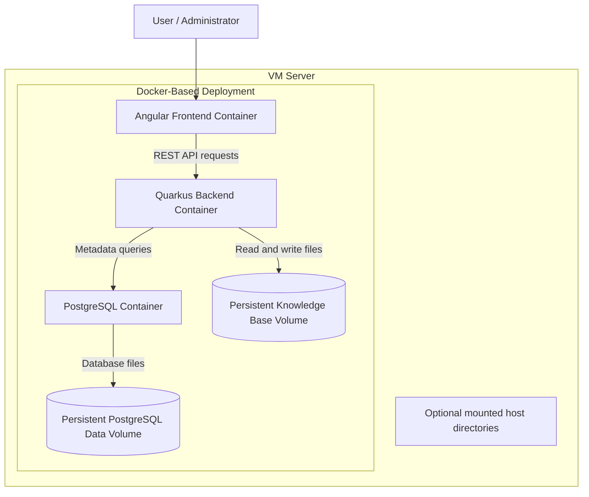

# TOGAFmate

**TOGAFmate** is an open-source Knowledge Bases application designed to help users organise, access, navigate, and read collections of knowledge documents through a web-based interface.

The application supports multiple Knowledge Bases, each containing Markdown documents and associated resources such as images. Knowledge Bases can contain learning material, technical documentation, reference information, and other authorised content.

TOGAFmate uses Angular for the frontend, Java with Quarkus for the backend, PostgreSQL for metadata and access control, and persistent filesystem storage for document content. The application uses a Docker-based deployment architecture on a VM server.

TOGAFmate is released under the **GNU General Public License v3.0 (GPL-3.0)**.

## 1. Objectives

TOGAFmate aims to provide:

- A central application for managing multiple **Architecture Methodologies and TOGAF as Knowledge Bases**.
- A consistent structure for all Knowledge Bases.
- A web-based interface for browsing and reading documents.
- ZIP-based Knowledge Base uploads.
- Persistent filesystem storage for Markdown documents and supporting resources.
- PostgreSQL storage for metadata and access permissions.
- Version identification for each Knowledge Base.
- Access control for readers and administrators.
- A secure mechanism for uploading, replacing, and removing Knowledge Bases.
- A Docker-based deployment model.
- An open-source platform that can be extended by the community.

## 2. Initial Features

### 2.1 Knowledge Base Management

TOGAFmate will support multiple independent Knowledge Bases.

Each Knowledge Base will have its own collection of documents and supporting resources.

Knowledge Bases may contain:

- Learning material.
- Technical documentation.
- Product documentation.
- Reference material.
- Standards and guidelines.
- Training material.
- Other authorised knowledge content.

Each Knowledge Base will have a title, version, description, content type, storage identifier, and associated document metadata.

Administrators will manage the Knowledge Base collection through the application.

### 2.2 Knowledge Base Content

A Knowledge Base will contain Markdown documents and any supporting resources required by those documents.

Supported content may include:

- Markdown files (`.md`).
- Images used by Markdown documents.
- Other supporting resources approved by the application.

The initial implementation will focus on Markdown documents and associated images.

The application will display Markdown content in a readable format through the Angular frontend.

### 2.3 Knowledge Base Navigation

Users will be able to browse the Knowledge Bases they are authorised to access.

The application will provide a Table of Contents for each Knowledge Base.

Users will be able to:

- Select a Knowledge Base.
- View its Table of Contents.
- Select a document.
- Read the document.
- Navigate to other documents within the same Knowledge Base.
- View associated images and other authorised resources.

The application will not require users to download an entire Knowledge Base to read an individual document.

### 2.4 Knowledge Base Import

Administrators will upload each Knowledge Base as a single ZIP file.

The backend will:

1. Receive the uploaded ZIP file.
2. Validate the archive and its contents.
3. Verify the required Knowledge Base structure.
4. Extract the files into the configured persistent filesystem storage.
5. Register the Knowledge Base and its documents in PostgreSQL.
6. Make the Knowledge Base available to authorised users.

The files will be extracted once during import. Subsequent document requests will read the extracted files rather than repeatedly extracting the ZIP archive.

### 2.5 Knowledge Base Administration

Administrators will be able to:

- Upload a Knowledge Base.
- Register its metadata.
- Replace an existing Knowledge Base version.
- Remove a Knowledge Base.
- Manage access permissions.
- View the registered documents and their metadata.

The application must validate changes before activating a new or replacement Knowledge Base.

Replacement and removal operations must avoid leaving database metadata and filesystem content inconsistent.

### 2.6 Search and Discovery

The initial application will provide basic Knowledge Base discovery.

Users should be able to locate Knowledge Bases and documents using available metadata, including:

- Knowledge Base title.
- Version.
- Description.
- Content type.
- Document name.
- Document title.
- Relevant tags, where supported.

More advanced full-text, semantic, and AI-assisted search may be considered for future releases.

## 3. Knowledge Base Content Types

Each Knowledge Base must specify one of the following content types.

### 3.1 Free

Content made available without a charge, subject to the applicable licence, copyright, and usage terms.

### 3.2 Open-source

Content distributed under an identified open-source licence or other applicable open licence.

The relevant licence must be identified where applicable.

### 3.3 Copyrighted

Content subject to copyright restrictions and the permissions granted by its copyright owner.

The administrator must ensure that the application is authorised to store and provide access to this content.

### 3.4 Content Type and Licensing

The content type describes the intended usage or distribution category of a Knowledge Base.

It does not replace the actual licence, copyright notice, or permission terms.

TOGAFmate must not assume that content is free to copy, modify, or redistribute simply because it is available without charge.

---

## 4. Application Architecture

TOGAFmate will use a **Docker-based deployment architecture** on a VM server. The application components will run in separate containers, with persistent storage for Knowledge Base documents and PostgreSQL data.

### 4.1 Architecture Components

- **Angular Frontend:** Provides the user interface for browsing, uploading, and managing Knowledge Bases.
- **Quarkus Backend:** Exposes REST APIs, implements business logic, validates ZIP uploads, manages access control, and serves Knowledge Base content.
- **PostgreSQL Database:** Stores Knowledge Base metadata, document metadata, permissions, and optional audit records.
- **Knowledge Base Filesystem:** Stores extracted Markdown documents, images, supporting resources, `README.md`, and `TABLE_OF_CONTENTS.md`.
- **Docker:** Provides containerisation for the application components and supports consistent deployment.
- **Persistent Knowledge Base Storage:** Stores extracted Knowledge Base files independently of the backend container lifecycle. The preferred implementation is a named Docker volume. A mounted host directory on the VM server is an alternative when direct host access to files is required.
- **Persistent PostgreSQL Storage:** Stores PostgreSQL database files independently of the database container lifecycle. It uses a separate named Docker volume or an appropriately configured persistent host directory.
- **VM Server:** Hosts the Docker deployment and provides the underlying disk storage for persistent volumes or mounted directories.

### 4.2 Target Deployment Architecture

The following diagram illustrates the target architecture. The two persistent storage locations are separate so that Knowledge Base files and PostgreSQL data can be managed and backed up independently.



The diagram shows the logical deployment. In the preferred configuration, named Docker volumes provide persistent storage. Alternatively, the deployment can use mounted host directories on the VM server. The application must use one configured persistent storage arrangement for each data store.

### 4.3 Knowledge Base Upload and Storage

1. An administrator uploads a Knowledge Base as a ZIP file through the Angular frontend.
2. The Quarkus backend validates the archive, including its paths, file types, structure, and size limits.
3. The backend extracts the archive into a temporary directory and validates the extracted content.
4. The backend activates the validated content in the configured persistent Knowledge Base storage location.
5. The backend stores the associated metadata and permissions in PostgreSQL.
6. Users access authorised Knowledge Base content through the REST API.

Knowledge Base documents are stored on the persistent filesystem, not inside the PostgreSQL database. PostgreSQL stores the associated metadata.

The configured storage root is controlled by the server and cannot be overridden by the uploaded archive.

### 4.4 Deployment Principles

- Deploy the Angular frontend, Quarkus backend, and PostgreSQL as separate Docker containers.
- Keep Knowledge Base documents on persistent storage independent of the backend container lifecycle.
- Keep PostgreSQL data on separate persistent storage independent of the database container lifecycle.
- Use a named Docker volume for Knowledge Base storage by default.
- Use a mounted host directory instead when administrators require direct access to Knowledge Base files on the VM server.
- Ensure the backend is the authorised access point for protected Knowledge Base content.
- Configure database credentials and other secrets securely; do not hard-code them into application source code.
- Ensure the deployment can be recreated consistently across development, testing, and production environments.
- Ensure that container replacement or recreation does not unintentionally delete persistent data.

---

## 5. Technology Stack

TOGAFmate will use a Docker-based containerised deployment architecture.

| Component | Technology |
|---|---|
| Frontend | Angular |
| Backend | Java / Quarkus |
| API | REST |
| Database | PostgreSQL |
| Document storage | Persistent server filesystem |
| Preferred Knowledge Base storage | Named Docker volume |
| Alternative Knowledge Base storage | Mounted host directory on the VM server |
| PostgreSQL storage | Separate persistent Docker volume or mounted host directory |
| Import format | ZIP |
| Document format | Markdown |
| Build | Gradle |
| Testing | JUnit |
| Code coverage | JaCoCo |
| Code quality | SonarQube |
| Containerisation | Docker |
| IDE | IntelliJ IDEA Community Edition |

The initial implementation will be designed to run locally using Docker and will also support development directly from IntelliJ IDEA Community Edition.

---

## 6. Knowledge Base Structure and Storage

TOGAFmate uses Docker containerisation for application deployment. Knowledge Base files are stored in persistent storage on the VM server and accessed by the application through a Docker volume or a mounted host directory.

A named Docker volume is the preferred option when administrators do not require direct access to individual files on the VM server.

### 6.1 Knowledge Base Metadata Fields

When an administrator uploads a Knowledge Base ZIP file, the application captures the following metadata.

| Field | Required / Optional | Description |
|---|---|---|
| `title` | Required | The title of the Knowledge Base. |
| `folder_name_version` | Required | The unique folder identifier derived from the Knowledge Base title and version. |
| `version` | Required | The version number of the Knowledge Base. |
| `author` | Optional | The author of the Knowledge Base. |
| `email_address` | Optional | The author's email address. |
| `Table_Of_Contents` | Optional | The Table of Contents content or resource reference, if provided. |

The application must validate all required fields before registering and activating a Knowledge Base.

Optional fields may be left blank. Their absence must not prevent an otherwise valid Knowledge Base from being uploaded.

The `folder_name_version` field identifies the Knowledge Base directory within the configured storage location. It must conform to the application's naming rules and must not contain an arbitrary filesystem path.

### 6.2 Knowledge Base README.md

Each Knowledge Base ZIP file must contain a `README.md` file describing the Knowledge Base.

The README must use a consistent structure so that TOGAFmate can validate and register the Knowledge Base metadata.

The following fields must be represented in the README.

| README field | Required / Optional |
|---|---|
| Title | Required |
| Folder Name and Version (`folder_name_version`) | Required |
| Version | Required |
| Author | Optional |
| Email Address | Optional |
| Table of Contents (`Table_Of_Contents`) | Optional |

#### 6.2.1 README Field Definitions

- **Title — Required:** The display title of the Knowledge Base.
- **Folder Name and Version — Required:** The identifier used for the Knowledge Base directory on persistent storage.
- **Version — Required:** The version number of the Knowledge Base.
- **Author — Optional:** The name of the person or organisation responsible for the content.
- **Email Address — Optional:** The author's contact email address.
- **Table of Contents — Optional:** A Table of Contents supplied with the Knowledge Base. If omitted, TOGAFmate may provide navigation using registered document metadata.

The README field names and their interpretation must be consistent across all Knowledge Bases.

#### 6.2.2 Example README.md

The following example shows all six fields, including the optional fields.

```markdown
# TOGAF Architecture Guide v1.0

## Title

TOGAF Architecture Guide

## Folder Name and Version

TOGAF_Architecture_Guide_v1.0

## Version

1.0

## Author (Optional)

Architecture Documentation Team

## Email Address (Optional)

architecture@example.com

## Table_Of_Contents (Optional)

TABLE_OF_CONTENTS.md
```

The example email address is illustrative and must be replaced with a valid address if an author email is supplied.

If the author, email address, or Table of Contents is not available, its field may be omitted or left blank according to the agreed README validation rules.

### 6.3 Knowledge Base Content Structure

Each Knowledge Base is stored in its own directory on the persistent filesystem. The directory name is derived from `folder_name_version`.

Example:

```text
KnowledgeBaseStorage/
└── TOGAF_Architecture_Guide_v1.0/
    ├── README.md
    ├── TABLE_OF_CONTENTS.md
    ├── Chapter_01.md
    ├── Chapter_02.md
    └── resources/
        ├── diagrams/
        └── images/
```

The `KnowledgeBaseStorage` directory is illustrative. In deployment, it maps to a named Docker volume or a mounted host directory on the VM server.

The actual filesystem path is configured by the deployment administrator. The uploaded ZIP archive cannot override the configured storage root.

### 6.4 ZIP Upload and Registration Process

When an administrator uploads a Knowledge Base ZIP file, the backend will:

1. Receive the ZIP file through the Angular frontend.
2. Validate the archive, including its file paths, file types, archive size, file count, and total extracted size.
3. Extract the archive into a temporary directory.
4. Locate and validate the `README.md` file.
5. Read and validate the required metadata fields: `title`, `folder_name_version`, and `version`.
6. Read the optional metadata fields: `author`, `email_address`, and `Table_Of_Contents`, when supplied.
7. Validate the extracted document structure and supporting resource paths.
8. Confirm that the Knowledge Base folder identifier conforms to the application's naming rules.
9. Activate the validated content in the configured persistent storage location.
10. Register the Knowledge Base metadata, document metadata, and permissions in PostgreSQL.
11. Make the Knowledge Base available to authorised users.

The backend must not activate an invalid or incomplete Knowledge Base.

If an import fails, temporary files must be cleaned up and the existing active Knowledge Base must remain usable.

### 6.5 Persistent Storage

- **Docker containerisation:** The application components run in Docker containers on the VM server.
- **Persistent Knowledge Base storage:** Extracted Knowledge Base files are stored in a named Docker volume or a mounted host directory on the VM server.
- **Preferred option:** Use a named Docker volume when direct host access to files is not required.
- **Alternative option:** Use a mounted host directory when administrators need direct access to the stored files.
- **Database storage:** PostgreSQL stores Knowledge Base metadata, document metadata, permissions, and optional audit records.
- **Separate storage:** PostgreSQL data and Knowledge Base files must use separate persistent storage locations.
- **Data persistence:** Knowledge Base files and database data must survive container restarts, upgrades, replacement, and recreation.
- **Storage configuration:** The deployment administrator configures the storage locations. Uploaded archives cannot override these locations.

The application must not store Knowledge Base documents only in a container's writable layer.

### 6.6 Backup and Recovery

- Backups must cover both PostgreSQL data and the persistent Knowledge Base filesystem.
- Backup and recovery procedures must maintain consistency between database metadata and stored files.
- Backups must be stored in a suitable separate location so that loss of the VM or its disk does not destroy both the live data and its backups.
- Recovery procedures must restore PostgreSQL and the corresponding Knowledge Base files to a mutually consistent state.
- Replacement and deletion operations must avoid leaving database metadata pointing to missing files or leaving obsolete files incorrectly registered as active.

Backup schedules, retention periods, and detailed recovery procedures will be defined during deployment design.

---

## 7. Knowledge Base README.md

Each Knowledge Base must contain a `README.md` file describing the Knowledge Base.

The README will provide the information required to identify and understand the content.

### 7.1 Title and Version Number

The title must include the Knowledge Base version number.

Example:

```text
TOGAF Architecture Guide v1.0
```

The title and version number will be used to determine the Knowledge Base folder name.

Example:

```text
TOGAF_Architecture_Guide_v1.0
```

The folder name must be unique within the configured Knowledge Base storage directory.

### 7.2 Description

The README must contain a short description explaining the purpose and contents of the Knowledge Base.

For example:

> A collection of learning materials covering TOGAF architecture concepts and the Architecture Development Method (ADM).

### 7.3 Knowledge Base Content Type

The README must identify one of the supported content types:

- Free.
- Open-source.
- Copyrighted.

The relevant licence or copyright terms must also be respected.

### 7.4 Target Folder

The README must identify the intended Knowledge Base folder.

For example:

```text
TOGAF_Architecture_Guide_v1.0
```

The target folder is an identifier, not an arbitrary filesystem path.

The actual storage location will be determined by the Quarkus backend configuration.

### 7.5 Example README.md

```markdown
# TOGAF Architecture Guide v1.0

## Description

A collection of learning materials covering TOGAF
architecture concepts and the Architecture Development
Method (ADM).

## Knowledge Base Content Type

Open-source

## Target Folder

TOGAF_Architecture_Guide_v1.0
```

The README structure must be consistent across all Knowledge Bases.

The backend will validate the required fields and verify that the folder identifier conforms to the application's naming rules.

---

## 8. Table of Contents

Each Knowledge Base will have a separate `TABLE_OF_CONTENTS.md` resource.

The Table of Contents will provide the navigation structure for the documents within that Knowledge Base.

### 8.1 Table of Contents Responsibilities

The Table of Contents will allow users to:

- See the available documents.
- Identify document titles.
- Select a document to read.
- Navigate between documents.
- Access supporting resources where authorised.

The Table of Contents is a navigation mechanism. It is not a second copy of the document content.

### 8.2 Table of Contents Data

The application will use the Knowledge Base files and document metadata to provide navigation.

The initial design will follow this process:

1. PostgreSQL stores metadata for each registered document.
2. The backend identifies the documents belonging to a Knowledge Base.
3. The backend provides the navigation data through a REST API.
4. Angular displays the Table of Contents.
5. The user selects a document.
6. The backend checks authorisation.
7. The backend retrieves and returns the requested Markdown content.

### 8.3 Table of Contents Implementation

Two implementation options have been identified.

**Option A — Angular component**

The backend provides document metadata through a REST API. Angular builds and displays the Table of Contents dynamically.

**Option B — HTML resource**

The Knowledge Base contains an HTML Table of Contents that the frontend displays or integrates into its navigation.

The implementation approach will be decided during detailed design.

Regardless of the chosen approach, the backend must enforce authorisation whenever a document or supporting resource is requested.

---

## 9. Common Storage and Processing

All Knowledge Bases will use the same storage and processing mechanism.

### 9.1 Import Process

The import process will:

1. Receive a ZIP file from an administrator.
2. Validate the archive.
3. Check the required Knowledge Base structure.
4. Validate the README and required metadata.
5. Check file types and archive limits.
6. Extract the files into a temporary directory.
7. Validate the extracted content and resource paths.
8. Move or activate the validated content in the configured persistent storage directory.
9. Register the Knowledge Base and document metadata in PostgreSQL.
10. Make the Knowledge Base available according to its access permissions.

The application must avoid exposing partially uploaded or invalid Knowledge Bases.

The import process must handle failures without corrupting an existing active Knowledge Base or leaving inconsistent database metadata.

### 9.2 Document Retrieval

When a user requests a document:

1. The backend identifies the requested Knowledge Base.
2. The backend checks the user's access permissions.
3. The backend validates the requested document identifier or path.
4. The backend locates the file within the configured Knowledge Base directory.
5. The backend reads the document from the filesystem.
6. The backend returns the content to the frontend.

The backend must not permit a request to access files outside the authorised Knowledge Base.

### 9.3 Filesystem and Database Responsibilities

The filesystem stores the actual content.

PostgreSQL stores metadata and application information.

| Information | Storage location |
|---|---|
| Knowledge Base Markdown files | Persistent filesystem |
| Images and supporting resources | Persistent filesystem |
| Knowledge Base README | Persistent filesystem |
| Table of Contents resource | Persistent filesystem |
| Knowledge Base title and version metadata | PostgreSQL |
| Document metadata | PostgreSQL |
| Access permissions | PostgreSQL |
| Administrative audit information | PostgreSQL, where required |

The application will not maintain duplicate copies of the Markdown documents in PostgreSQL.

The Knowledge Base filesystem and PostgreSQL data will use separate persistent storage locations.

### 9.4 Replacing a Knowledge Base

When an administrator replaces a Knowledge Base, the application must validate the replacement before making it available.

The application must prevent users from accessing an incomplete replacement.

The implementation must also define how failed imports are rolled back and how previous versions are retained or removed.

Replacement operations must consider both PostgreSQL metadata and filesystem content. The application must not leave metadata pointing to missing files or leave obsolete content that is incorrectly registered as active.

The exact replacement and retention policy will be decided during detailed design.

### 9.5 Removing a Knowledge Base

When an administrator removes a Knowledge Base, the application must coordinate the removal of its metadata and stored files.

The implementation must define how it handles failures during removal so that the database and filesystem do not become inconsistent.

Where appropriate, the application should use a controlled deletion or recovery mechanism rather than immediately and irreversibly deleting content.

The detailed deletion and recovery policy will be decided during detailed design.

---

## 10. Access Control and Security

TOGAFmate will distinguish between readers and administrators.

### 10.1 Readers

Readers will be able to:

- Browse Knowledge Bases they are authorised to access.
- View their Tables of Contents.
- Read authorised Markdown documents.
- Access authorised supporting resources.

Readers will not be able to upload, replace, or remove Knowledge Bases or change permissions.

### 10.2 Administrators

Administrators will be able to:

- Upload Knowledge Bases.
- Manage Knowledge Base metadata.
- Replace or remove Knowledge Bases.
- Manage access permissions.
- Maintain the Knowledge Base collection.
- Review administrative operations where audit logging is implemented.

Administrative functions must be protected against unauthorised use.

### 10.3 Server-Side Authorisation

The backend must enforce authorisation for every protected operation.

This includes:

- Listing restricted Knowledge Bases.
- Reading document content.
- Accessing images and other resources.
- Uploading ZIP files.
- Replacing Knowledge Bases.
- Removing Knowledge Bases.
- Changing permissions.

Hiding links or buttons in Angular is not sufficient security.

The backend must independently verify the user's permissions before performing the requested operation.

### 10.4 ZIP Upload Security

Uploaded ZIP files must be treated as untrusted input.

The backend must protect against:

- ZIP path traversal, commonly called Zip Slip.
- Attempts to write outside the configured storage directory.
- Absolute paths and unsafe path components.
- Unexpected file types.
- Excessive archive sizes.
- Excessive numbers of files.
- Excessive extracted sizes.
- Malformed or corrupted archives.
- Unexpected directory structures.
- Unsafe references to supporting resources.

The backend must use a server-configured storage root and must not trust filesystem paths supplied by the archive.

### 10.5 Safe Activation

A Knowledge Base must not become available until validation and extraction have completed successfully.

The application should extract content to a temporary directory and activate it only after validation.

If an import fails, the application must clean up temporary files and avoid leaving inconsistent metadata or partially active content.

Replacement and removal operations must also be designed to preserve database and filesystem consistency when failures occur.

---

## 11. Development Principles

TOGAFmate will follow these development principles:

- Open-source development under GPL-3.0.
- API-first development.
- Separation of frontend and backend.
- Separation of metadata from document content.
- PostgreSQL for structured metadata and permissions.
- Persistent filesystem storage for Markdown and supporting resources.
- Separate persistent storage for Knowledge Base files and PostgreSQL data.
- Consistent structure for all Knowledge Bases.
- ZIP as the initial import format.
- Secure document access through the backend.
- Server-side authorisation for all protected operations.
- Coordinated backup and recovery for database metadata and filesystem content.
- Safe replacement and removal of Knowledge Bases.
- Automated testing.
- Continuous code-quality analysis.
- Containerised deployment using Docker.
- Prefer proven technologies over reinventing functionality.
- Keep the platform extensible.
- Maintain clear and complete documentation.

---

## 12. Initial Project Scope

The initial release will concentrate on establishing the core Knowledge Bases application.

The scope includes:

1. Angular web interface.
2. Java/Quarkus backend.
3. REST API.
4. PostgreSQL database.
5. Knowledge Base metadata management.
6. Document metadata management.
7. ZIP upload and validation.
8. Safe extraction to persistent server filesystem storage.
9. Knowledge Base folder structure validation.
10. README validation.
11. Table of Contents display.
12. Markdown document retrieval and display.
13. Supporting image retrieval.
14. Reader and administrator roles.
15. Access permission management.
16. Server-side authorisation.
17. Safe replacement and removal of Knowledge Bases.
18. Docker containerisation.
19. Persistent storage configuration for Knowledge Base files and PostgreSQL data.
20. Backup and recovery procedures for persistent data.
21. Automated testing.
22. JaCoCo code coverage.
23. SonarQube integration.

Additional capabilities, including advanced search and AI-assisted knowledge discovery, may be introduced in later releases.

### 12.1 Excluded Applications and Responsibilities

TOGAFmate is the **Knowledge Bases application**.

The following capabilities belong to separate programs and are not part of this application's scope:

- A TOGAF Architecture Repository for managing architecture artefacts and their governance workflows.
- An Architecture Decision Repository for managing architecture decisions and their lifecycle.

TOGAFmate will not implement those repositories as modules within this application.

Its responsibility is to manage Knowledge Bases and provide secure access to their content.

---

## 13. Project Status

**Status: PLANNING**

TOGAFmate is currently in the planning and initial design phase.

The core technology choices, Docker-based deployment architecture, and Knowledge Base storage approach have been identified.

Detailed design is still required for areas such as:

- The final Table of Contents implementation.
- Authentication integration.
- Database schema.
- REST API contracts.
- Knowledge Base replacement and deletion policies.
- Persistent volume and host-directory configuration.
- Backup schedules, retention, and recovery procedures.
- Deployment configuration for the VM server.

The project will progress through requirements definition, detailed design, implementation, testing, and deployment.

---

## 14. Contributing

TOGAFmate is intended to be an open-source project, and contributions are welcome.

Contributors will be able to participate in:

- Application development.
- Backend development.
- Frontend development.
- Database design.
- Security and access control.
- User interface and user experience.
- Knowledge Base examples.
- Documentation.
- Testing.
- Feature development.

Contribution guidelines will be added as the project matures.

---

## 15. License

TOGAFmate is licensed under the **GNU General Public License version 3.0 (GPL-3.0)**.

The software may be used, modified, and distributed in accordance with the terms of that licence.

When distributing the software or derivative works, the applicable GPL-3.0 requirements must be followed.

The licence for the TOGAFmate application does not automatically determine the licence or usage rights of documents uploaded into its Knowledge Bases. Knowledge Base administrators remain responsible for ensuring that uploaded content may lawfully be stored and made available to its intended users.

For the complete licence terms, see the [GNU General Public License v3.0](https://www.gnu.org/licenses/gpl-3.0.htm).

The repository should include the corresponding `LICENSE` file.
